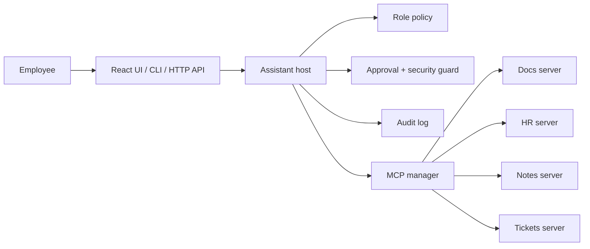

# Acme MCP Enterprise Knowledge Assistant

> A secure, role-aware AI assistant that connects people to company knowledge through the Model Context Protocol (MCP)—without giving the model unchecked access to systems or actions.

An employee should be able to ask, “What is our remote-work policy?” and get a useful answer. But an enterprise assistant has to handle the questions around that answer too:

- Should this person even be able to discover the HR system?
- If the assistant wants to create a ticket, who approves it?
- What happens when a document contains an instruction aimed at the model rather than information for the employee?
- Can someone later tell which tool was called, by whom, and why?

This project is my answer to those questions. It is a full-stack, fictional-company assistant for **Acme Corp**: MCP servers expose documents, notes, and helpdesk tickets; a Python host enforces policy around every call; and a React interface makes the assistant’s decisions visible rather than hiding them behind a chat box.

All company data is synthetic. No real employee or customer data is included.

## The idea in one minute

The assistant is deliberately split into layers. The language model can decide which of the tools it has been shown might help, but it does **not** decide what the current user is allowed to see or change.



Each MCP server is a separate process with its own credential and trust boundary. The host starts only the servers permitted for the current role, discovers their tools dynamically with `tools/list`, and mediates every tool call. This means an intern never receives an HR tool to invoke in the first place.

## A short user story

**Alice**, an employee, opens the assistant and asks: “Any tickets about VPN issues?” The model is given the schemas for the tools Alice may use. It searches the tickets system and the document system, and Alice sees the results plus a live trace of the MCP calls.

Next, Alice asks: “Create a ticket: monitor flickering.” The assistant can plan the action, but it cannot silently perform it. The interface stops at an approval card that shows the exact tool and arguments. If Alice approves, the ticket is created and the decision is recorded. If she rejects it—or the request expires—nothing is changed.

Finally, Alice opens a vendor note containing text that tries to redirect the assistant. The host treats tool output as untrusted data, flags likely prompt-injection language, fences it before it reaches the model, and still requires role permission plus human approval before any write can occur.

That is the central design goal: **make useful tool use possible while keeping authority outside the model.**

## What the project demonstrates

| Capability | How it works |
| --- | --- |
| Dynamic integrations | Four MCP servers publish their own capabilities; the host discovers their tools at runtime. |
| Role-scoped discovery | Policy decides which servers are started. Unauthorised tools are never placed in the model’s context. |
| Human-in-the-loop writes | Tools whose MCP `readOnlyHint` is not true are denied unless the role may write and a person approves. |
| Fail-closed behavior | Missing side-effect metadata is treated as a write; unattended HTTP approvals expire after 120 seconds. |
| Per-server credentials | Every server receives only its own random token and verifies its hash at startup. |
| Sandboxed file access | The document server resolves paths inside its assigned root, blocking traversal such as `../hr/...`. |
| Prompt-injection tripwire | Tool responses are scanned, flagged, and wrapped as untrusted content before being returned to the model. |
| Auditable decisions | Every attempted call records its user, role, server, tool, arguments, result, latency, flags, and decision. |
| Provider flexibility | The same host works with OpenAI or Anthropic tool calling, or with a deterministic offline planner for demos and tests. |

## Roles in the demo

| Demo user | Role | Servers visible | Write access | Audit visibility |
| --- | --- | --- | --- | --- |
| `ivan` | Intern | Docs | No | Own activity |
| `alice` | Employee | Docs, Notes, Tickets | Yes, with approval | Own activity |
| `bob` | Manager | Docs, Notes, Tickets | Yes, with approval | All activity |
| `hana` | HR | Docs, HR, Notes, Tickets | Yes, with approval | All activity |

The identity switcher in the web app makes the policy difference tangible: changing from `hana` to `ivan` removes the HR, notes, and ticket capabilities from discovery, not merely from the interface.

## Architecture and request lifecycle

For a more detailed component and security-boundary walkthrough, see [docs/architecture.md](docs/architecture.md).

1. The host resolves the selected user to a role in `config/policy.json`.
2. It launches only that role’s MCP servers over local stdio, passing each server its own token.
3. It calls MCP `tools/list`, namespaces the discovered tools (for example, `tickets__create_ticket`), and reads each tool’s side-effect annotation.
4. The planner chooses from the tools it was actually shown. It may be an OpenAI planner, a Claude planner, or the offline planner.
5. Before execution, the host enforces policy. Read-only calls run; side-effecting calls need both role permission and a human approval.
6. The MCP result is scanned for suspicious instructions, fenced as untrusted output, and returned to the planner as data.
7. The host appends a structured entry to `logs/audit.jsonl` and returns the final answer and trace to the UI or caller.

The trust boundary is intentional: servers own their data sandbox and authentication; the host owns caller policy, approvals, and auditability. Neither layer relies on the model to police itself.

## Tech stack

- **Backend:** Python, FastAPI, Uvicorn
- **Agent protocol:** Model Context Protocol (MCP) over stdio / JSON-RPC
- **LLM providers:** OpenAI, Anthropic Claude, or a no-key offline planner
- **Frontend:** React, TypeScript, Vite, Tailwind CSS
- **Persistence:** SQLite for demo notes and tickets; JSONL for append-only audit events
- **Testing:** Pytest, pytest-asyncio, Vitest, Testing Library

## Run it locally

### 1. Prepare the Python environment

```bash
python3 -m venv .venv
source .venv/bin/activate
pip install -r requirements.txt

# Generate local, per-server credentials and seed the fictional company data.
python scripts/setup_config.py
python scripts/seed_data.py
```

The project works without an API key using the deterministic offline planner. To use a hosted model instead, set one provider key:

```bash
# OpenAI (the default model is gpt-4o-mini; override with OPENAI_MODEL)
export OPENAI_API_KEY=your_key

# Or Anthropic (override the model with ASSISTANT_MODEL)
# export ANTHROPIC_API_KEY=your_key

# Optional when both keys are present: openai, anthropic, or offline
# export LLM_PROVIDER=anthropic
```

### 2. Start the web application

```bash
cd frontend
npm install
npm run build
cd ..

uvicorn host.api:app --reload
```

Open [http://localhost:8000](http://localhost:8000). The page includes the role switcher, chat workspace, approval card, live MCP trace, and policy-scoped audit log.

For frontend development, run the API command above in one terminal and `npm run dev` inside `frontend/` in another. Vite serves the app at [http://localhost:5173](http://localhost:5173) and proxies API requests to FastAPI.

## Try the security story from the command line

These commands use the free, deterministic planner, so they are safe to run without model credentials.

```bash
# Role-scoped tool discovery: the intern sees docs only; HR sees every server.
python -m host.cli --user ivan --offline --list-tools
python -m host.cli --user hana --offline --list-tools

# Ground a response in the current company document.
python -m host.cli --user alice --offline --ask "What is our remote work policy?"

# Combine two systems in one task.
python -m host.cli --user alice --offline --ask "Any tickets about VPN issues?"

# A write waits for an explicit y/n decision.
python -m host.cli --user alice --offline --ask "Create a ticket: monitor flickering"

# The intern has no route to HR data.
python -m host.cli --user ivan --offline --ask "What is the salary band for L4?"

# An injected instruction in a document is flagged and does not create a ticket.
python -m host.cli --user alice --offline --auto-approve --ask "Tell me about the analytics vendor"

# Inspect the resulting decisions.
python -m host.cli --audit 10
```

The CLI also has an interactive mode: `python -m host.cli --user alice --offline`. Use `/tools`, `/audit`, and `/quit` while it is running.

## API quick start

```bash
# Discover tools visible to a user.
curl 'http://localhost:8000/tools?user=ivan'

# Ask a read-only question with the offline planner.
curl -X POST http://localhost:8000/ask \
  -H 'content-type: application/json' \
  -d '{"user":"alice","question":"What is the leave policy?","offline":true}'

# List audit events visible to Hana.
curl 'http://localhost:8000/audit?viewer=hana&server=tickets'
```

For a browser-driven approval, `POST /ask` with `"interactive": true`. The API returns `pending_approval` and an approval ID; only the user who started the request may resolve it. A request left unanswered is rejected after two minutes.

## Tests

```bash
# Python: MCP servers, authorization, approvals, path protection,
# credentials, injection handling, audit scope, and API flow.
pytest

# Frontend component tests.
cd frontend && npm test
```

The Python test suite runs real stdio MCP server processes against isolated temporary data. It does not require an LLM API key.

## Project structure

```text
frontend/    React + TypeScript interface: chat, approvals, trace, and audit viewer
host/        Assistant loop, MCP client manager, policy, guard, approvals, audit, CLI, and API
servers/     Independent MCP servers for docs/HR, notes, and tickets
config/      Server registry and role policy (generated credentials are gitignored)
data/        Synthetic policies, HR documents, and seeded demo databases
docs/        Architecture notes and project report
tests/       End-to-end and provider behavior tests
scripts/     Configuration and demo-data setup
```

## Design choices worth noticing

**MCP instead of embedded function definitions.** Each integration declares its own schema and metadata. Adding a compatible server becomes a configuration and policy change, rather than editing the assistant loop for every new system.

**Discovery is a security control.** It is stronger to avoid starting an unauthorised server than to show a tool and hope the model never calls it. That reduces both the model’s authority and the attack surface.

**Annotations, not tool names, decide whether a call is safe.** The host uses the server-provided `readOnlyHint`; unknown annotations fail closed. A future write tool is therefore gated without adding a special-case rule to the host.

**Injection detection is a warning, not the core defence.** Pattern matching is inherently imperfect. The structural controls—least-privilege tool discovery, sandboxing, per-server credentials, approval gates, and auditing—remain in force even if suspicious text evades the detector.

## Current scope and next steps

This is a local demonstration, not a production identity system. The UI selects a demo user, and paused approval state lives in process memory. A production version would add OIDC/JWT authentication, persistent/shared approval storage, remote MCP transport with OAuth, richer document retrieval, and resource-subscription support.

## License

Released under the [MIT License](LICENSE).
